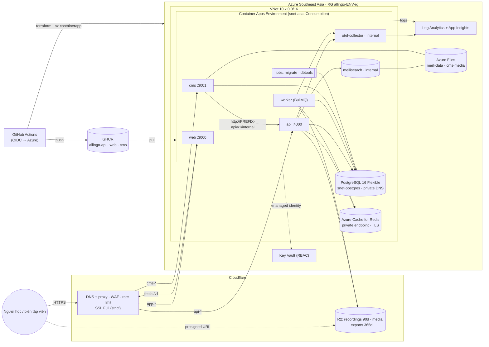

# infra/terraform

IaC cho **phương án B** ([ADR-0023](../../docs/adr/0023-infra-azure-container-apps.md), trạng thái *Proposed* – chốt tại GATE-1):
Azure Container Apps (Southeast Asia) + PostgreSQL Flexible Server + Azure Cache for Redis + Key Vault, Cloudflare R2/DNS/WAF.
Khung theo ADR-0014: mỗi môi trường một thư mục `envs/<env>` với state riêng.

Liên quan: [deploy staging](../../docs/runbooks/deploy-staging.md) · [secret](../../docs/runbooks/secrets.md) ·
`.github/workflows/deploy-staging.yml` · `infra/scripts/aca.sh` · `infra/docker/compose.staging-like.yml` (chạy thử image cục bộ).

> Trạng thái kiểm chứng: HCL đã parse và kiểm tra chéo tham chiếu (biến/output/module) bằng công cụ ngoài terraform;
> **chưa chạy `terraform validate`/`plan`** (phiên viết mã không có terraform). Lần chạy đầu: `scripts/validate.sh`
> hoặc job `terraform-validate` trong `.github/workflows/preview.yml`, rồi commit `.terraform.lock.hcl`.

## Kiến trúc



| Module | Nội dung |
| --- | --- |
| `network` | VNet, subnet uỷ quyền cho Container Apps (/24) và PostgreSQL (/28), subnet private endpoint, Private DNS zone Postgres/Redis |
| `observability` | Log Analytics (trần ingest/ngày) + Application Insights workspace-based |
| `postgres` | Flexible Server 16, chỉ trong VNet, allowlist extension `VECTOR,CITEXT,PG_TRGM,PGCRYPTO,PG_STAT_STATEMENTS`, mật khẩu admin/app sinh ngẫu nhiên, SQL tạo vai trò `allingo_app` (không BYPASSRLS) |
| `redis` | Azure Cache for Redis (Basic C0), `noeviction` cho BullMQ, private endpoint, TLS 1.2 |
| `storage` | Cloudflare R2: 3 bucket + lifecycle + CORS, custom domain cho `media`, API token R2 → khoá S3 |
| `secrets` | Key Vault (RBAC), user-assigned identity `Key Vault Secrets User`, ghi secret do Terraform sinh |
| `compute` | Container Apps Environment + `api`/`worker`/`web`/`cms` (+ `otel` tuỳ chọn), jobs `migrate`/`dbtools`, Azure Files cho CMS, custom domain (Origin CA) |
| `search` | Meilisearch (Container App internal, 1 replica, dữ liệu Azure Files) |
| `cdn-waf` | Zone settings (SSL strict, Always HTTPS, TLS ≥ 1.2, WebSocket), WAF custom rules, rate limit `/v1/auth/*`, dải IP Cloudflare |
| `dns` | CNAME `app/api/cms<suffix>` → FQDN Container Apps (proxied), TXT `asuid.*` xác minh custom domain |

Quy ước: tên tài nguyên `allingo-<env>-<thành phần>`; tên duy nhất toàn cầu (Key Vault, storage account) thêm hậu tố ngẫu nhiên
4 ký tự cố định trong state. Secret Key Vault đặt tên theo ENV viết thường, gạch ngang (`DATABASE_URL` → `database-url`).
`envs/dev/main.tf` và `envs/staging/main.tf` **giống hệt nhau** (khác ở `variables.tf` và `terraform.tfvars`); `scripts/validate.sh` cảnh báo nếu lệch.

**Phân vai Terraform ↔ pipeline:** Terraform tạo hạ tầng và cấu hình app (env, secret, probe, scale, ingress). Image và traffic giữa các
revision do `deploy-staging.yml`/`infra/scripts/aca.sh` quản lý (`lifecycle.ignore_changes` trên image, revision suffix, traffic) –
biến `image_tag` chỉ dùng khi tạo app lần đầu.

## Yêu cầu
- Terraform ≥ 1.9 (CI dùng `~1.13.0`), Azure CLI ≥ 2.60 + extension `containerapp`, quyền trên subscription Azure và tài khoản Cloudflare.
- Provider: `azurerm ~> 4.0` (bản 4.x mới), `cloudflare ~> 5.0` (cú pháp v5: `cloudflare_dns_record`, `cloudflare_ruleset`, `cloudflare_zone_setting`), `random`, `time`.

## Bootstrap (một lần cho mỗi subscription/môi trường)

```bash
SUB=<subscription-id>; LOC=southeastasia
az account set -s "$SUB"

# 1. Resource provider (Terraform đặt resource_provider_registrations = "none")
for ns in Microsoft.App Microsoft.OperationalInsights Microsoft.Insights Microsoft.DBforPostgreSQL Microsoft.Cache \
          Microsoft.KeyVault Microsoft.Network Microsoft.Storage Microsoft.ManagedIdentity; do
  az provider register -n "$ns"; done

# 2. State Terraform (blob, Entra ID, versioning + soft delete)
az group create -n allingo-tfstate-rg -l "$LOC"
az storage account create -n stallingotfstate -g allingo-tfstate-rg -l "$LOC" --sku Standard_LRS \
  --min-tls-version TLS1_2 --allow-blob-public-access false --allow-shared-key-access false
az storage account blob-service-properties update -n stallingotfstate -g allingo-tfstate-rg \
  --enable-versioning true --enable-delete-retention true --delete-retention-days 30
az storage container create -n tfstate --account-name stallingotfstate --auth-mode login

# 3. Danh tính cho GitHub Actions (OIDC, không client secret)
az ad app create --display-name gh-allingo-staging           # → appId = AZURE_CLIENT_ID
az ad sp create --id <appId>
for env in staging-plan staging; do
  az ad app federated-credential create --id <appId> --parameters "{\"name\":\"gh-$env\",\"issuer\":\"https://token.actions.githubusercontent.com\",\"subject\":\"repo:<owner>/<repo>:environment:$env\",\"audiences\":[\"api://AzureADTokenExchange\"]}"
done
# Quyền: Contributor (tạo RG + tài nguyên) + Role Based Access Control Administrator (module secrets gán vai trò Key Vault)
#        + Storage Blob Data Contributor trên container tfstate. Có thể giới hạn RBAC Admin bằng điều kiện chỉ cho
#        "Key Vault Secrets User/Officer". Người chạy Terraform trên máy dev cần quyền tương đương.
az role assignment create --assignee <appId> --role Contributor --scope "/subscriptions/$SUB"
az role assignment create --assignee <appId> --role "Role Based Access Control Administrator" --scope "/subscriptions/$SUB"
az role assignment create --assignee <appId> --role "Storage Blob Data Contributor" \
  --scope "$(az storage account show -n stallingotfstate -g allingo-tfstate-rg --query id -o tsv)/blobServices/default/containers/tfstate"
```

4. **Cloudflare API token** cho Terraform (Account → API Tokens): Account – *Workers R2 Storage: Edit*; Zone (`allingo.vn`) – *Zone: Read*,
   *Zone Settings: Edit*, *DNS: Edit*, *Zone WAF: Edit*, *SSL and Certificates: Edit*; User – *API Tokens: Edit* (chỉ khi
   `r2_create_api_token = true`, để tạo token R2 cho ứng dụng). Lưu ở GitHub environment secret `CLOUDFLARE_API_TOKEN`.
5. **Origin CA** (SSL Full strict): Cloudflare → SSL/TLS → Origin Server → tạo chứng chỉ cho `*.allingo.vn, allingo.vn` (RSA, 15 năm),
   đóng gói PFX (`docs/runbooks/secrets.md`) → `ORIGIN_CERT_PFX_BASE64` / `ORIGIN_CERT_PASSWORD`.
6. **GHCR:** package private → PAT classic `read:packages` của tài khoản máy → `GHCR_PULL_TOKEN` + `ghcr_username` trong tfvars.

## Chạy trên máy dev

```bash
cd infra/terraform/envs/staging            # hoặc envs/dev
cp terraform.tfvars.example terraform.tfvars   # sửa giá trị (không đặt secret)
export CLOUDFLARE_API_TOKEN=...            # hoặc TF_VAR_cloudflare_api_token
export TF_VAR_origin_certificate_pfx_base64="$(base64 -w0 origin.pfx)" TF_VAR_origin_certificate_password=...
az login && az account set -s <subscription-id>

terraform init -backend-config=backend.local.hcl
terraform plan -out=tfplan
terraform apply tfplan                      # staging: ưu tiên chạy qua workflow (có phê duyệt)
terraform output                            # không có output bí mật; secret xem trong Key Vault
```

Kiểm tra không cần credentials: `infra/terraform/scripts/validate.sh` (fmt + init `-backend=false` + validate mọi env).
Thứ tự lần apply đầu (image phải có trên GHCR, vai trò DB app tạo sau migration, xác minh custom domain): xem
[runbook – Bootstrap staging](../../docs/runbooks/deploy-staging.md#1-bootstrap-lần-đầu).

## Biến bắt buộc

| Biến | Ví dụ | Ghi chú |
| --- | --- | --- |
| `image_owner` | `allingo-org` | Owner GHCR (`ghcr.io/<owner>/allingo-*`) |
| `cloudflare_account_id` | `0123…cdef` | Tài khoản chứa R2 (luôn cần, kể cả khi `enable_cloudflare = false`) |
| `cloudflare_api_token` *(sensitive)* | – | Hoặc biến môi trường `CLOUDFLARE_API_TOKEN` |
| `cloudflare_zone_id`, `cloudflare_zone_name` | `…`, `allingo.vn` | Bắt buộc khi `enable_cloudflare = true` (mặc định staging) |
| `origin_certificate_pfx_base64` *(sensitive)* | – | Bắt buộc khi `enable_cloudflare = true` |
| `subscription_id` | – | Tuỳ chọn; mặc định `ARM_SUBSCRIPTION_ID`/`az account` |

Biến hay chỉnh: `image_tag` (CI truyền `sha-<commit>`), `ghcr_username`/`ghcr_pull_token`, `app_scale`, `ai_provider`, `speech_provider`,
`smtp_*`, `api_extra_env` (env không bí mật), `external_secret_env` (secret bên thứ ba đã đặt tay trong Key Vault),
`dns_name_suffix`, `cloudflare_proxied`, `cloudflare_manage_zone_settings`/`cloudflare_manage_waf` (một state mỗi zone),
`restrict_ingress_to_cloudflare`, `admin_allowed_ips`.

| Khác biệt | dev | staging |
| --- | --- | --- |
| api / web / cms | 0.25–0.5 vCPU, **min 0** (scale-to-zero) | 0.5 vCPU / 1 GiB, **min 1** |
| worker | 0.25 vCPU / 0.5 GiB, min 1 | như dev |
| Postgres / Redis | B1ms, HA tắt / Basic C0 | như dev (HA tắt) |
| Meilisearch | 0.25 vCPU / 0.5 GiB | 0.5 vCPU / 1 GiB |
| OTel collector | tắt | bật (App Insights, lấy mẫu 50%) |
| Log Analytics | 30 ngày, trần 1 GB/ngày | 90 ngày, trần 2 GB/ngày |
| Cloudflare edge | tắt (FQDN `*.azurecontainerapps.io`) | bật, ingress chỉ nhận IP Cloudflare |
| Key Vault purge protection | tắt | bật |

## Chi phí ước tính / tháng

> **Ước tính** theo bảng giá công khai pay-as-you-go (USD, chưa VAT, chưa reserved/savings plan) cho Southeast Asia tại thời điểm viết;
> giá thực tế thay đổi theo region, tỷ giá và mức sử dụng. Kiểm tra lại bằng Azure Pricing Calculator trước GATE-1.

| Hạng mục | dev | staging | Cơ sở tính |
| --- | ---: | ---: | --- |
| Container Apps (Consumption) | 10–20 | 60–110 | Luôn bật: dev 0.5 vCPU/1 GiB (worker + meili), staging 2.5 vCPU/5 GiB (6 app); phần lớn thời gian ở mức giá *idle*; trừ free grant 180k vCPU-s + 360k GiB-s |
| PostgreSQL Flexible B1ms + 32 GB | 16–20 | 16–20 | Compute burstable + storage; backup ≤ 100% dung lượng miễn phí |
| Azure Cache for Redis Basic C0 | 16–19 | 16–19 | 250 MB, không SLA |
| Private endpoint (Redis) + 2 Private DNS zone | 8–9 | 8–9 | ~7,3 USD/endpoint + 0,5 USD/zone |
| Log Analytics + App Insights | 0–5 | 5–30 | ~2,5–3 USD/GB sau 5 GB miễn phí/tháng; trần ingest/ngày chặn chi phí bất ngờ |
| Azure Files (meili, cms-media) + Key Vault | 2–6 | 3–10 | Theo dung lượng dùng + giao dịch; Key Vault < 1 USD |
| IP công khai/egress của environment | 4–6 | 4–8 | IP tĩnh do ACA tạo; 100 GB egress đầu miễn phí |
| Cloudflare (Free) + R2 | 0 | 0 (Pro: +20) | R2 miễn phí 10 GB + 1M/10M thao tác; gói Pro nếu cần thêm rule WAF/rate limit |
| GHCR | 0 | 0 | Hiện miễn phí lưu trữ/băng thông container registry (chính sách GitHub có thể đổi) |
| **Tổng ước tính** | **≈ 60–85** | **≈ 115–200** | |

Đòn bẩy giảm chi phí: dev thay Redis + private endpoint (~25 USD) bằng Valkey chạy trên Container Apps; tắt dev ngoài giờ
(`az containerapp update --min-replicas 0` cho worker/meili); reserved capacity cho Postgres khi lên production.

## Giới hạn & rủi ro đã biết
Xem ADR-0023 mục *Consequences*: lưu trữ dữ liệu trong nước (NĐ 53), lộ trình ngừng Azure Cache for Redis (30/09/2028),
Meilisearch trên SMB, Socket.IO nhiều replica, gọi nội bộ CMS → API, zone Cloudflare dùng chung, xác minh custom domain khi proxied,
media Payload chưa sang R2.
